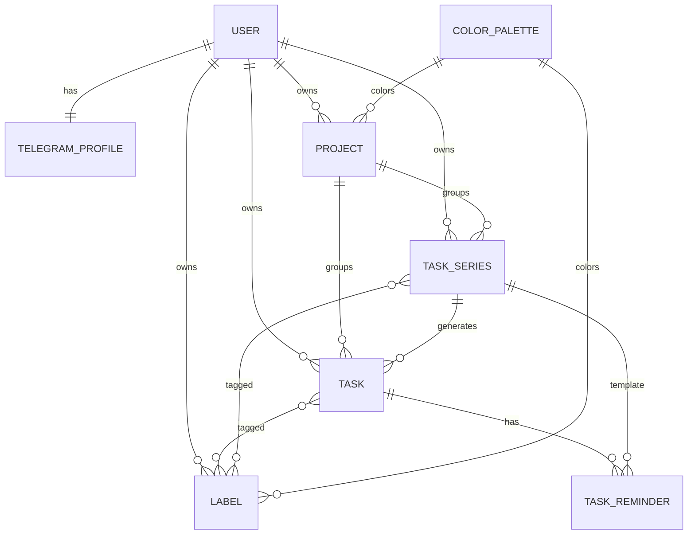

# Milly API — подробное руководство для frontend-агента

> **Источник истины по схемам, типам и параметрам — `GET /openapi.json`.**
> Этот документ объясняет то, чего нет в OpenAPI: смысл эндпоинтов, связи
> сущностей, побочные эффекты, порядок вызовов и типичные сценарии фронтенда.
> При расхождении доверяйте `openapi.json` и коду, а этот файл используйте как
> карту поведения.

---

## 0. TL;DR для агента

1. Базовый префикс API — `/api/v1` (настраивается через `API_V1_STR`).
   Health-проверки лежат вне префикса: `/health/live`, `/health/ready`.
2. Все бизнес-эндпоинты требуют `Authorization: Bearer <access_token>`.
   Access-токен живёт около 15 минут и хранится только в памяти фронтенда.
3. Refresh-токен — HttpOnly-cookie. Для `POST /api/v1/auth/telegram`,
   `POST /api/v1/auth/refresh`, `POST /api/v1/auth/logout` нужен
   `credentials: "include"` (или `withCredentials: true`).
4. Ошибки всегда приходят в едином конверте
   `{error, code, message, description, details?, request_id}`. Показывайте
   пользователю `description`, логируйте `code` и `request_id`.
5. Все ID — целые положительные числа. Пользователь видит только свои
   проекты, метки, задачи и серии. Чужой ID возвращает `404 not_found`, а не
   `403`.
6. Списки `GET /projects` и `GET /tasks` пагинируются курсором:
   `{items, next_cursor}`. Курсор непрозрачный, привязан к пользователю и
   фильтрам. Передавайте его обратно вместе с теми же фильтрами.
7. `due_at` — обязательный datetime с часовым поясом. `time_of_day` у серий и
   напоминаний — локальное время без часового пояса. Даты — `YYYY-MM-DD`.
8. Разовая задача создаётся через `POST /tasks`. Повторяющаяся — через
   `POST /task-series` либо через `PATCH /tasks/{id}` с полем `recurrence`.
9. Редактирование экземпляра серии через `PATCH /tasks/{id}` меняет серию и её
   будущие незавершённые экземпляры. Прошлое и завершённое не переписывается.
10. Удаление задачи из серии может удалить всю серию. Матрица поведения —
    в разделе «Удаление задачи».

---

## 1. Подключение и OpenAPI

### 1.1. Где взять OpenAPI

При `ENABLE_DOCS=true` (в dev обычно включено) доступны:

| Что | URL |
| --- | --- |
| OpenAPI JSON | `GET /openapi.json` |
| Swagger UI | `GET /docs` |
| ReDoc | `GET /redoc` |

В production docs обычно отключены, и эти маршруты отвечают `404 not_found`.
Для генерации клиента или проверки схем используйте `openapi.json`.

В OpenAPI каждая операция документирует единый `ErrorResponse` для `400`,
`404`, `422`, `500` и `503`, а также специфичные для операции статусы
(`401`, `403`, `409` и т.п.).

```bash
curl -fsS http://localhost:8000/openapi.json -o openapi.json
```

### 1.2. Operation ID

В OpenAPI у каждой операции стабильный `operationId` вида
`<tag>-<имя_функции>`. По нему удобно искать операцию в сгенерированном
клиенте.

| operationId | Метод и путь |
| --- | --- |
| `auth-telegram_login` | `POST /api/v1/auth/telegram` |
| `auth-refresh_tokens` | `POST /api/v1/auth/refresh` |
| `auth-logout` | `POST /api/v1/auth/logout` |
| `auth-read_current_user` | `GET /api/v1/auth/me` |
| `auth-update_timezone` | `PATCH /api/v1/auth/me/timezone` |
| `color-palette-read_color_palette` | `GET /api/v1/color-palette` |
| `projects-list_projects` | `GET /api/v1/projects` |
| `projects-create_project` | `POST /api/v1/projects` |
| `projects-read_project` | `GET /api/v1/projects/{project_id}` |
| `projects-update_project` | `PATCH /api/v1/projects/{project_id}` |
| `projects-archive_project` | `POST /api/v1/projects/{project_id}/archive` |
| `projects-unarchive_project` | `POST /api/v1/projects/{project_id}/unarchive` |
| `projects-delete_project` | `DELETE /api/v1/projects/{project_id}` |
| `labels-list_labels` | `GET /api/v1/labels` |
| `labels-create_label` | `POST /api/v1/labels` |
| `labels-update_label` | `PATCH /api/v1/labels/{label_id}` |
| `labels-delete_label` | `DELETE /api/v1/labels/{label_id}` |
| `tasks-list_tasks` | `GET /api/v1/tasks` |
| `tasks-create_task` | `POST /api/v1/tasks` |
| `tasks-read_task` | `GET /api/v1/tasks/{task_id}` |
| `tasks-update_task` | `PATCH /api/v1/tasks/{task_id}` |
| `tasks-complete_task` | `POST /api/v1/tasks/{task_id}/complete` |
| `tasks-uncomplete_task` | `POST /api/v1/tasks/{task_id}/uncomplete` |
| `tasks-delete_task` | `DELETE /api/v1/tasks/{task_id}` |
| `tasks-read_today_progress` | `GET /api/v1/tasks/today/progress` |
| `task-series-list_series` | `GET /api/v1/task-series` |
| `task-series-create_series` | `POST /api/v1/task-series` |
| `task-series-read_series` | `GET /api/v1/task-series/{series_id}` |
| `task-series-update_series` | `PATCH /api/v1/task-series/{series_id}` |
| `task-series-delete_series` | `DELETE /api/v1/task-series/{series_id}` |
| `health-live` | `GET /health/live` |
| `health-ready` | `GET /health/ready` |

### 1.3. Общие заголовки

| Заголовок | Назначение |
| --- | --- |
| `Authorization: Bearer <access_token>` | Доступ к бизнес-эндпоинтам |
| `Content-Type: application/json` | Тела `POST`/`PATCH` |
| `X-Request-ID` | Необязательный клиентский ID запроса. Если он соответствует `^[A-Za-z0-9._-]{1,64}$`, сервер сохранит его; иначе сгенерирует новый. Всегда возвращается в ответе |
| `Origin` | Проверяется на `POST /auth/telegram`, `POST /auth/refresh`, `POST /auth/logout` |

### 1.4. Cookie refresh-сессии

| Параметр | Значение |
| --- | --- |
| Имя | `milly_refresh` (настраивается `AUTH_REFRESH_COOKIE_NAME`) |
| `HttpOnly` | Да, JavaScript не может прочитать значение |
| `Secure` | `AUTH_REFRESH_COOKIE_SECURE`, в production — `true` |
| `SameSite` | `Lax` по умолчанию (`AUTH_REFRESH_COOKIE_SAMESITE`) |
| `Path` | `/api/v1/auth` |
| `Max-Age` | 30 дней по умолчанию (`AUTH_REFRESH_TTL_SECONDS`) |

Cookie автоматически отправляется только на `/api/v1/auth/*`. На остальные
эндпоинты её передавать не нужно и нельзя прочитать из JS.

### 1.5. CORS и браузерные ограничения

- `CORS_ORIGINS` должен содержать origin фронтенда.
- Разрешены credentials, все методы и заголовки; `X-Request-ID` выставлен
  наружу.
- Отклонённый CORS preflight — документированное исключение: plain-text `400`
  от Starlette, без JSON-конверта. Прикладной JS это тело не читает.
- `Origin` на auth-маршрутах должен совпадать с origin самого API или быть в
  `CORS_ORIGINS`. Запрос без `Origin` (не-браузерный клиент) разрешён.
- Если TLS завершается на reverse proxy, публичный origin фронтенда/API должен
  быть явно добавлен в `CORS_ORIGINS`.

### 1.6. Лимиты

- Тело запроса — до 1 МиБ по умолчанию (`MAX_REQUEST_BODY_BYTES`). Превышение
  даёт `413 payload_too_large`.
- Rate limit — 60 запросов за 60 секунд на клиентский IP по умолчанию.
  Превышение даёт `429 rate_limited` и заголовок `Retry-After` (секунды).
- Счётчики rate limit живут в памяти процесса и не разделяются между
  воркерами.

---

## 2. Форматы данных

| Тип | Формат | Пример |
| --- | --- | --- |
| `datetime` | ISO 8601 / RFC 3339 с обязательным offset | `2026-11-05T12:00:00Z`, `2026-11-05T15:00:00+03:00` |
| `date` | `YYYY-MM-DD` | `2026-11-05` |
| `time` | Локальное время без зоны | `09:00:00` |
| ID | Целое > 0 | `42` |
| Цвет | Объект `{id, slug, name, hex}` | `{"id":1,"slug":"blue","name":"Синий","hex":"#2563EB"}` |

Границы дат и времени:

- `due_at` должен быть timezone-aware и попадать в диапазон
  `2025-01-01T00:00:00Z … 2100-12-31T23:59:59.999999Z` включительно.
- `date`, `starts_on`, `ends_on` должны попадать в
  `2025-01-01 … 2100-12-31` включительно.
- Наивный `due_at` (без зоны) — `422 validation_error`.
- `time_of_day` с зоной — `422 validation_error`.

Строки, которые обрезаются сервером:

- `Project.name`, `Label.name`, `Task.title`, `Series.title` обрезаются по
  краям. Строка только из пробелов отклоняется.
- `Task.description`, `Project.description`, `Series.description` не
  обрезаются.

---

## 3. Модель данных и связи



Ключевые правила:

- **Пользователь** — корень владения. Проекты, метки, задачи и серии всегда
  принадлежат одному пользователю. Палитра цветов — глобальная.
- **Проект** объединяет задачи и серии. У проекта есть цвет из палитры и
  вычисляемый прогресс.
- **Метка** — пользовательская сущность с цветом. Метки назначаются задачам и
  сериям. В ответах задач и серий метка представлена только `{id, name}`;
  цвет берите из `GET /labels`.
- **Серия** — шаблон повторяющейся задачи. Она хранит расписание, часовой пояс,
  метки и шаблонные напоминания. Из серии генерируются **экземпляры** —
  обычные задачи с `series_id`.
- **Задача** может быть разовой (`series_id = null`) или экземпляром серии
  (`series_id != null`). Поле `recurrence` вычисляется: `one_off`,
  `regular` (daily-серия) или `periodic` (серия с интервалом).
- **Напоминания** есть у задач и у серий. У серии это шаблоны с
  `next_run_at = null`; экземпляры получают копии правил с вычисленным
  `next_run_at`.
- **Прогресс проекта** считается по всем неудалённым задачам проекта, включая
  экземпляры серий: `total`, `completed` (есть `completed_at`),
  `remaining = total - completed`.
- **Soft-delete**: удалённые сущности исчезают из чтения и возвращают `404`.
  Исключение — `DELETE /labels/{id}`: он идемпотентен и всегда отвечает `204`.

### 3.1. Что вложено в ответы, а что нет

| Ответ | Вложенные данные | Чего нет |
| --- | --- | --- |
| `ProjectResponse` | `color`, `progress` | Списка задач |
| `LabelResponse` | `color` | Задач с этой меткой |
| `TaskResponse` | `labels` (`id`, `name`), `reminders`, `project_id`, `series_id`, `recurrence` | Объекта проекта, цвета меток, объекта серии |
| `SeriesResponse` | `labels`, шаблонные `reminders`, расписание | `project_id`, списка сгенерированных задач |

Если фронтенду нужен цвет метки задачи — загрузите `GET /labels` и сопоставьте
по `id`. Если нужен проект задачи — используйте `project_id` и список
проектов. Если нужны экземпляры серии — запросите `GET /tasks` (например, с
фильтром по проекту или дате).

---

## 4. Ошибки API

Все ошибки (кроме отклонённого CORS preflight) имеют вид:

```json
{
  "error": true,
  "code": "validation_error",
  "message": "Request validation failed",
  "description": "Проверьте правильность заполнения полей",
  "details": {
    "fields": [
      {
        "field": "body.title",
        "code": "required",
        "description": "Обязательное поле"
      }
    ]
  },
  "request_id": "5f0c2b4e8a9d4c1f"
}
```

Правила:

- `error` всегда `true`.
- `code` — стабильный машинный код; используйте его в логике.
- `message` — технический английский текст для логов.
- `description` — русский текст для пользователя.
- `details` отсутствует, если деталей нет.
- `request_id` совпадает с заголовком `X-Request-ID`.
- `401 unauthorized` сопровождается заголовком `WWW-Authenticate: Bearer`.
- В production у `500` нет `details`. В debug там могут быть тип и текст
  исключения. Для поддержки используйте `request_id`.

### 4.1. Коды ошибок

| `code` | HTTP | Когда возникает |
| --- | --- | --- |
| `bad_request` | 400 | Некорректный JSON, невалидный курсор, недопустимое доменное значение, архивный проект, `interval_days` без `recurrence` для не-periodic цели |
| `validation_error` | 422 | Ошибка схемы: отсутствует поле, неверный тип/формат, нарушены `min`/`max`, неизвестный enum, наивный `due_at`, невалидная IANA-зона, несовместимая матрица `recurrence`/`interval_days`, дубликат вида напоминания |
| `unauthorized` | 401 | Нет/невалиден access-токен; refresh-cookie отсутствует, истёк, отозван или переиспользован |
| `forbidden` | 403 | `Origin` auth-запроса не разрешён |
| `auth_not_configured` | 503 | Не заданы `TELEGRAM_BOT_TOKEN` или `AUTH_JWT_SECRET` |
| `not_found` | 404 | Ресурс не существует, удалён или принадлежит другому пользователю |
| `method_not_allowed` | 405 | Метод не поддерживается маршрутом |
| `conflict` | 409 | Дубликат имени проекта/метки, конфликт при unarchive, последний активный цвет палитры (админка) |
| `payload_too_large` | 413 | Тело больше лимита |
| `unsupported_media_type` | 415 | Неподдерживаемый `Content-Type` |
| `rate_limited` | 429 | Превышен rate limit; смотрите `Retry-After` |
| `internal_error` | 500 | Непредвиденная ошибка сервера |
| `not_implemented` | 501 | Функция не реализована |
| `service_unavailable` | 503 | Временная недоступность сервиса |
| `database_unavailable` | 503 | Недоступна БД (readiness) |
| `task_enqueue_failed` | 503 | Не удалось поставить фоновую задачу в очередь |

### 4.2. Коды ошибок полей

В `details.fields[].code` используются:

`required`, `invalid_type`, `invalid_format`, `too_short`, `too_long`,
`out_of_range`, `invalid_value`, `invalid_json`.

`field` — путь с точками: `body.title`, `body.reminders.0.kind`,
`query.limit`, `path.task_id`. Значения полей и внутренние сообщения Pydantic
в ответ не попадают.

### 4.3. Как обрабатывать ошибки на фронтенде

1. `401 unauthorized` — попробуйте `POST /auth/refresh`. Если refresh тоже
   вернул `401`, очистите сессию и покажите повторный вход через Telegram.
2. `422 validation_error` — разберите `details.fields` и подсветьте поля формы.
3. `429 rate_limited` — подождите `Retry-After` секунд.
4. `409 conflict` — покажите пользователю конфликт имени/состояния.
5. `5xx` — покажите общий текст и `request_id` для поддержки.

---

## 5. Аутентификация

### 5.1. Жизненный цикл токенов

```text
Telegram.WebApp.initData
        │
        ▼
POST /api/v1/auth/telegram ──► access_token (в память) + refresh cookie
        │
        ├─ Authorization: Bearer <access_token> ──► бизнес-эндпоинты
        │
        └─ access истёк (~15 мин)
                │
                ▼
        POST /api/v1/auth/refresh ──► новый access_token + ротация cookie
                │
                └─ 401 ──► повторный вход через Telegram
```

- Access-токен: JWT HS256, TTL 900 секунд плюс 30 секунд leeway при проверке.
- Refresh-токен: непрозрачная строка, в БД хранится только SHA-256 хеш.
- Refresh строго ротируется. Повтор старого токена вне 30-секундного
  grace-окна отзывает всё семейство.
- Ошибка refresh не очищает cookie. Logout очищает.
- Access-токен после logout не отзывается мгновенно и живёт до `exp`
  (около 15 минут).

### 5.2. `POST /api/v1/auth/telegram`

**operationId:** `auth-telegram_login`
**Auth:** нет
**Назначение:** вход по подписанным данным запуска Telegram Mini App.

Тело:

```json
{
  "init_data": "query_id=...&user=...&auth_date=...&hash=..."
}
```

| Поле | Тип | Обязательно | Ограничения |
| --- | --- | --- | --- |
| `init_data` | string | Да | 1…8192 символа; сырая строка `Telegram.WebApp.initData` |

Ответ `200`:

```json
{
  "access_token": "<jwt>",
  "token_type": "bearer",
  "expires_in": 900,
  "user": {
    "id": 1,
    "timezone": "UTC",
    "created_at": "2026-11-05T09:00:00Z",
    "telegram_profile": {
      "telegram_id": 123456789,
      "is_bot": false,
      "first_name": "Иван",
      "last_name": null,
      "username": "ivan",
      "language_code": "ru",
      "is_premium": false,
      "added_to_attachment_menu": null,
      "allows_write_to_pm": null,
      "photo_url": null
    }
  }
}
```

Ответ также ставит HttpOnly-cookie refresh-токена.

Поведение:

- Проверяется HMAC-SHA256 с секретом, производным от bot token.
- `auth_date` должен быть не старше 3600 секунд и не более чем на 60 секунд
  в будущем.
- Пользователи с `is_bot=true` отклоняются.
- `initDataUnsafe` не принимается.
- Пустой или неподписанный `init_data` авторизовать нельзя.
- При каждом логине создаётся новое семейство refresh-сессий.
- Сырые init data и токены не логируются.

Ошибки:

- `401 unauthorized` — init data невалидна, просрочена или принадлежит боту.
- `403 forbidden` — `Origin` не разрешён.
- `422 validation_error` — отсутствует/пустой/слишком длинный `init_data`.
- `503 auth_not_configured` — не настроены bot token или JWT secret.

### 5.3. `POST /api/v1/auth/refresh`

**operationId:** `auth-refresh_tokens`
**Auth:** refresh-cookie
**Тело:** нет.

Ответ `200`:

```json
{
  "access_token": "<jwt>",
  "token_type": "bearer",
  "expires_in": 900
}
```

Cookie refresh-токена ротируется и перезаписывается.

Поведение:

- Читает refresh из cookie `milly_refresh`.
- Не требует `Authorization`.
- Ошибки refresh не очищают существующую cookie.
- Повтор старого токена вне grace-окна (30 секунд) отзывает всё семейство.

Ошибки:

- `401 unauthorized` — cookie отсутствует, токен неизвестен, истёк, отозван
  или переиспользован.
- `403 forbidden` — `Origin` не разрешён.
- `503 auth_not_configured` — не настроен JWT secret.

### 5.4. `POST /api/v1/auth/logout`

**operationId:** `auth-logout`
**Auth:** refresh-cookie (необязательно)
**Тело:** нет.
**Ответ:** `204 No Content`.

Поведение:

- Отзывает всё семейство refresh-токенов.
- Очищает cookie.
- Идемпотентен: отсутствие или неизвестность cookie не является ошибкой.
- Не требует access-токен.

Ошибки:

- `403 forbidden` — `Origin` не разрешён.

### 5.5. `GET /api/v1/auth/me`

**operationId:** `auth-read_current_user`
**Auth:** Bearer
**Ответ `200`:** `UserResponse` (как `user` из логина).

Ошибки:

- `401 unauthorized` — токен отсутствует/невалиден, пользователь удалён или у
  него нет Telegram-профиля.
- `503 auth_not_configured` — не настроен JWT secret.

### 5.6. `PATCH /api/v1/auth/me/timezone`

**operationId:** `auth-update_timezone`
**Auth:** Bearer
**Назначение:** сохранить IANA-часовой пояс пользователя.

Тело:

```json
{
  "timezone": "Europe/Moscow"
}
```

| Поле | Тип | Обязательно | Ограничения |
| --- | --- | --- | --- |
| `timezone` | string | Да | 1…64 символа, валидная IANA-зона |

Ответ `200` — обновлённый `UserResponse`.

Зачем это фронтенду:

- Часовой пояс влияет на фильтр `date` в `GET /tasks`.
- Он используется для локальных слотов `scheduled`-напоминаний разовых задач.
- После смены пояса перезапросите список задач и отображение дат.

Ошибки:

- `401 unauthorized` — нет/невалиден токен или пользователь удалён.
- `422 validation_error` — неизвестная IANA-зона.
- `503 auth_not_configured` — не настроен JWT secret.

---

## 6. Палитра цветов

### 6.1. `GET /api/v1/color-palette`

**operationId:** `color-palette-read_color_palette`
**Auth:** Bearer
**Назначение:** список активных цветов для выбора проекта/метки.

Ответ `200`:

```json
{
  "items": [
    {
      "id": 1,
      "slug": "blue",
      "name": "Синий",
      "hex": "#2563EB"
    },
    {
      "id": 2,
      "slug": "green",
      "name": "Зелёный",
      "hex": "#16A34A"
    }
  ]
}
```

Поведение:

- Возвращаются только активные цвета.
- Порядок — `(sort_order, id)`.
- Публичных эндпоинтов создания/редактирования палитры нет; это админка.
- Проект или метка могут хранить уже деактивированный цвет. Тогда
  `GET /color-palette` его не вернёт, но в ответе проекта/метки цвет всё равно
  будет.
- При создании проекта/метки без `color_id` выбирается первый активный цвет.
  Если активных цветов нет — `400 bad_request`.

Ошибки:

- `401 unauthorized`.

---

## 7. Проекты

### 7.1. Модель проекта

```json
{
  "id": 10,
  "name": "Работа",
  "description": "Рабочие задачи",
  "icon": "briefcase",
  "color": {
    "id": 1,
    "slug": "blue",
    "name": "Синий",
    "hex": "#2563EB"
  },
  "progress": {
    "total": 12,
    "completed": 5,
    "remaining": 7
  },
  "archived_at": null,
  "created_at": "2026-11-01T10:00:00Z",
  "updated_at": "2026-11-05T09:30:00Z"
}
```

- `progress.total` — все неудалённые задачи проекта, включая экземпляры серий.
- `progress.completed` — задачи с `completed_at != null`.
- `progress.remaining` — `total - completed`.
- `archived_at != null` — проект в архиве.
- `icon` — свободная строка до 32 символов; сервер её не интерпретирует.

### 7.2. `GET /api/v1/projects`

**operationId:** `projects-list_projects`
**Auth:** Bearer
**Назначение:** страница проектов с прогрессом и цветом.

Query-параметры:

| Параметр | Тип | По умолчанию | Описание |
| --- | --- | --- | --- |
| `include_archived` | bool | `false` | Включить архивные проекты |
| `limit` | int | `50` | Размер страницы, 1…100 |
| `cursor` | string | — | Непрозрачный курсор следующей страницы |

Ответ `200`:

```json
{
  "items": [
    {
      "id": 10,
      "name": "Работа",
      "description": null,
      "icon": null,
      "color": {
        "id": 1,
        "slug": "blue",
        "name": "Синий",
        "hex": "#2563EB"
      },
      "progress": {
        "total": 3,
        "completed": 1,
        "remaining": 2
      },
      "archived_at": null,
      "created_at": "2026-11-01T10:00:00Z",
      "updated_at": "2026-11-01T10:00:00Z"
    }
  ],
  "next_cursor": null
}
```

Поведение:

- Порядок: сначала активные, затем архивные; внутри — `lower(name)`, затем
  `id`. То есть `(is_archived, lower(name), id)`.
- `include_archived=false` — только активные.
- `include_archived=true` — активные и архивные, активные идут первыми.
- Курсор привязан к пользователю и к `include_archived`. При следующей
  странице передавайте тот же `include_archived`.
- `limit` не входит в привязку курсора, но для предсказуемости передавайте
  тот же размер страницы.
- Невалидный, слишком длинный или чужой курсор — `400 bad_request`
  (`"Invalid pagination cursor"`).

Ошибки:

- `400 bad_request` — невалидный курсор.
- `401 unauthorized`.
- `404 not_found` — проект ссылается на отсутствующий цвет (аномалия данных).

### 7.3. `POST /api/v1/projects`

**operationId:** `projects-create_project`
**Auth:** Bearer
**Ответ:** `201 Created`, `ProjectResponse`.

Тело:

```json
{
  "name": "Работа",
  "description": "Рабочие задачи",
  "color_id": 1,
  "icon": "briefcase"
}
```

| Поле | Тип | Обязательно | Ограничения |
| --- | --- | --- | --- |
| `name` | string | Да | 1…120, обрезается; уникально среди активных проектов без учёта регистра |
| `description` | string \| null | Нет | До 5000 |
| `color_id` | int \| null | Нет | > 0; должен быть активным. `null`/отсутствие — первый активный цвет |
| `icon` | string \| null | Нет | До 32 |

Поведение:

- Имя проверяется на уникальность среди неудалённых и неархивных проектов,
  без учёта регистра.
- Архивный проект может иметь имя, совпадающее с активным; при unarchive
  возникнет `409`.
- Ответ содержит нулевой прогресс.

Ошибки:

- `400 bad_request` — невалидный/неактивный цвет, нет активных цветов.
- `401 unauthorized`.
- `409 conflict` — активный проект с таким именем уже есть.
- `422 validation_error` — пустое имя после trim, превышение длины,
  `color_id <= 0`.

### 7.4. `GET /api/v1/projects/{project_id}`

**operationId:** `projects-read_project`
**Auth:** Bearer
**Ответ:** `200`, `ProjectResponse`.

Ошибки:

- `401 unauthorized`.
- `404 not_found` — проект не существует, удалён или принадлежит другому
  пользователю.

### 7.5. `PATCH /api/v1/projects/{project_id}`

**operationId:** `projects-update_project`
**Auth:** Bearer
**Ответ:** `200`, `ProjectResponse`.

Тело — любое подмножество полей:

```json
{
  "name": "Работа и карьера",
  "description": null,
  "color_id": 2,
  "icon": null
}
```

Поведение:

- Отсутствующее поле не меняется.
- Явный `null` для `description` или `icon` очищает поле.
- Явный `null` для `name` или `color_id` игнорируется (значение не меняется).
- Смена имени проверяет уникальность среди активных проектов.
- Смена цвета требует активный цвет.

Ошибки:

- `400 bad_request` — невалидный/неактивный цвет.
- `401 unauthorized`.
- `404 not_found` — проект не найден.
- `409 conflict` — активный проект с таким именем уже есть.
- `422 validation_error` — пустое имя после trim, превышение длины,
  `color_id <= 0`.

### 7.6. `POST /api/v1/projects/{project_id}/archive`

**operationId:** `projects-archive_project`
**Auth:** Bearer
**Тело:** нет.
**Ответ:** `200`, `ProjectResponse` с `archived_at != null`.

Поведение:

- Проект скрывается из списков по умолчанию.
- Генерация его серий и доставка напоминаний останавливаются: слоты
  напоминаний очищаются, активные доставки отменяются.
- Задачи проекта не удаляются, но `GET /tasks` по умолчанию их скрывает
  (`include_archived_projects=false`).
- Повторная архивация сохраняет исходный `archived_at`.
- Unarchive пересчитывает будущие слоты от текущего времени без догоняющих
  отправок.

Ошибки:

- `401 unauthorized`.
- `404 not_found`.

### 7.7. `POST /api/v1/projects/{project_id}/unarchive`

**operationId:** `projects-unarchive_project`
**Auth:** Bearer
**Тело:** нет.
**Ответ:** `200`, `ProjectResponse` с `archived_at = null`.

Поведение:

- Возвращает проект в активные списки.
- Если проект уже активен — ничего не меняет.
- Если имя проекта уже занято другим активным проектом — `409 conflict`.
- Будущие напоминания пересчитываются от текущего времени; пропущенные слоты
  не догоняются.

Ошибки:

- `401 unauthorized`.
- `404 not_found`.
- `409 conflict` — имя занято активным проектом.

### 7.8. `DELETE /api/v1/projects/{project_id}`

**operationId:** `projects-delete_project`
**Auth:** Bearer
**Ответ:** `204 No Content`.

Поведение:

- Soft-delete проекта.
- Все неудалённые серии и задачи проекта также помечаются удалёнными.
- Активные доставки напоминаний отменяются.
- После удаления проект, его задачи и серии недоступны (`404`).
- Повторный вызов — `404`.

Ошибки:

- `401 unauthorized`.
- `404 not_found`.

---

## 8. Метки

### 8.1. Модель метки

```json
{
  "id": 3,
  "name": "Срочно",
  "color": {
    "id": 4,
    "slug": "red",
    "name": "Красный",
    "hex": "#DC2626"
  },
  "created_at": "2026-11-01T10:00:00Z",
  "updated_at": "2026-11-01T10:00:00Z"
}
```

- Метки принадлежат пользователю.
- Имя уникально среди неудалённых меток без учёта регистра.
- В ответах задач и серий метка представлена только `{id, name}`.

### 8.2. `GET /api/v1/labels`

**operationId:** `labels-list_labels`
**Auth:** Bearer
**Ответ:** `200`.

```json
{
  "items": [
    {
      "id": 3,
      "name": "Срочно",
      "color": {
        "id": 4,
        "slug": "red",
        "name": "Красный",
        "hex": "#DC2626"
      },
      "created_at": "2026-11-01T10:00:00Z",
      "updated_at": "2026-11-01T10:00:00Z"
    }
  ]
}
```

Поведение:

- Пагинации нет.
- Порядок — `lower(name)`, затем `id`.
- Возвращаются только неудалённые метки.

Ошибки:

- `401 unauthorized`.
- `404 not_found` — метка ссылается на отсутствующий цвет (аномалия данных).

### 8.3. `POST /api/v1/labels`

**operationId:** `labels-create_label`
**Auth:** Bearer
**Ответ:** `201 Created`, `LabelResponse`.

Тело:

```json
{
  "name": "Срочно",
  "color_id": 4
}
```

| Поле | Тип | Обязательно | Ограничения |
| --- | --- | --- | --- |
| `name` | string | Да | 1…60, обрезается; уникально среди неудалённых меток без учёта регистра |
| `color_id` | int \| null | Нет | > 0; активный цвет. `null`/отсутствие — первый активный цвет |

Ошибки:

- `400 bad_request` — невалидный/неактивный цвет.
- `401 unauthorized`.
- `409 conflict` — метка с таким именем уже есть.
- `422 validation_error` — пустое имя после trim, превышение длины,
  `color_id <= 0`.

### 8.4. `PATCH /api/v1/labels/{label_id}`

**operationId:** `labels-update_label`
**Auth:** Bearer
**Ответ:** `200`, `LabelResponse`.

Тело — любое подмножество:

```json
{
  "name": "Очень срочно",
  "color_id": 5
}
```

Поведение:

- Отсутствующее поле не меняется.
- Явный `null` для `name` или `color_id` игнорируется.
- Смена имени проверяет уникальность.
- Смена цвета требует активный цвет.

Ошибки:

- `400 bad_request` — невалидный/неактивный цвет.
- `401 unauthorized`.
- `404 not_found` — метка не найдена.
- `409 conflict` — метка с таким именем уже есть.
- `422 validation_error` — пустое имя после trim, превышение длины,
  `color_id <= 0`.

### 8.5. `DELETE /api/v1/labels/{label_id}`

**operationId:** `labels-delete_label`
**Auth:** Bearer
**Ответ:** `204 No Content`.

Поведение:

- Soft-delete метки.
- Идемпотентно: отсутствующая, уже удалённая или чужая метка всё равно даёт
  `204`.
- Назначения метки на задачах и сериях сохраняются в БД, но удалённая метка
  исчезает из ответов задач и серий.
- Восстановления метки нет.

Ошибки:

- `401 unauthorized`.

---

## 9. Задачи

### 9.1. Модель задачи

```json
{
  "id": 100,
  "series_id": null,
  "project_id": 10,
  "title": "Подготовить отчёт",
  "description": "К понедельнику",
  "priority": "urgent_important",
  "recurrence": "one_off",
  "due_at": "2026-11-06T12:00:00Z",
  "completed_at": null,
  "reminders_enabled": true,
  "labels": [
    {
      "id": 3,
      "name": "Срочно"
    }
  ],
  "reminders": [
    {
      "id": 50,
      "kind": "before_due",
      "enabled": true,
      "offset_minutes": 30,
      "interval_days": null,
      "time_of_day": null,
      "timezone": null,
      "next_run_at": "2026-11-06T11:30:00Z"
    }
  ],
  "created_at": "2026-11-05T09:00:00Z",
  "updated_at": "2026-11-05T09:00:00Z"
}
```

Поля:

- `series_id` — `null` для разовой задачи; иначе ID серии. У задачи
  soft-deleted серии `series_id` сохраняется, а `recurrence` остаётся
  `regular`/`periodic`, чтобы история не теряла регулярность.
- `project_id` — `null`, если задача без проекта.
- `priority` — `urgent_important`, `important_not_urgent`,
  `urgent_not_important`, `neither`.
- `recurrence` — вычисляемое: `one_off`, `regular`, `periodic`.
- `completed_at` — `null`, пока задача не завершена.
- `labels` — только `id` и `name`; цвета берите из `GET /labels`.
- `reminders` — правила и ближайший слот `next_run_at`. У завершённой задачи
  слоты очищаются (`next_run_at = null`), но правила остаются.
- `reminders_enabled` — мастер-выключатель доставки.

### 9.2. `GET /api/v1/tasks`

**operationId:** `tasks-list_tasks`
**Auth:** Bearer
**Назначение:** страница задач с фильтрами, метками и напоминаниями.

Query-параметры:

| Параметр | Тип | По умолчанию | Описание |
| --- | --- | --- | --- |
| `date` | date | — | Локальный день пользователя (`YYYY-MM-DD`) |
| `project_ids` | int, повторяемый | — | Ограничить проектами: `?project_ids=1&project_ids=2` |
| `priorities` | enum, повторяемый | — | `?priorities=urgent_important&priorities=neither` |
| `status` | enum | `all` | `all`, `open`, `completed`, `overdue` |
| `recurrence` | enum | `all` | `all`, `regular`, `periodic`, `one_off` |
| `q` | string | — | Поиск подстроки без учёта регистра по `title` и `description` |
| `include_archived_projects` | bool | `false` | Включить задачи архивных проектов |
| `limit` | int | `50` | 1…100 |
| `cursor` | string | — | Курсор следующей страницы |

Ответ `200`:

```json
{
  "items": [
    {
      "id": 100,
      "series_id": null,
      "project_id": 10,
      "title": "Подготовить отчёт",
      "description": null,
      "priority": "neither",
      "recurrence": "one_off",
      "due_at": "2026-11-06T12:00:00Z",
      "completed_at": null,
      "reminders_enabled": false,
      "labels": [],
      "reminders": [],
      "created_at": "2026-11-05T09:00:00Z",
      "updated_at": "2026-11-05T09:00:00Z"
    }
  ],
  "next_cursor": null
}
```

Семантика фильтров:

- `date` — локальный день в часовом поясе пользователя. Границы
  `[00:00, следующие 00:00)` переводятся в UTC. Задача с `due_at` ровно в
  полночь попадает в день; ровно в следующие полночь — уже в следующий.
- `project_ids` — OR внутри списка. Несуществующие ID просто ничего не
  находят.
- `priorities` — OR внутри списка.
- `status=open` — `completed_at IS NULL`; включает просроченные задачи.
- `status=completed` — `completed_at IS NOT NULL`.
- `status=overdue` — `completed_at IS NULL AND due_at < now` (строгое `<`);
  только просроченные.
- `recurrence=regular` — задачи daily-серий.
- `recurrence=periodic` — задачи periodic-серий.
- `recurrence=one_off` — задачи с `series_id IS NULL`.
- `q` — `ILIKE %q%` по `title` или `description`. Пустая строка игнорируется.
  Пробелы и регистр в запросе не нормализуются.
- `include_archived_projects=false` — скрывает задачи, у которых проект в
  архиве. Задачи без проекта при этом видны.
- По умолчанию `status=all`, поэтому в ответ попадают и завершённые задачи.
  Для списка «к выполнению» передавайте `status=open`.
- Порядок: `(due_at, id)` по возрастанию.

Пагинация:

- Курсор привязан к пользователю и к отпечатку фильтров: `date`,
  `include_archived_projects`, отсортированные `priorities`,
  отсортированные `project_ids`, `q`, `recurrence`, `status`.
- `limit` в отпечаток не входит, но передавайте тот же размер страницы.
- Если изменить фильтры и передать старый курсор — `400 bad_request`
  (`"Invalid pagination cursor"`).
- Курсор длиннее 512 символов или невалидный — `400 bad_request`.
- `next_cursor = null` означает последнюю страницу.

Ошибки:

- `400 bad_request` — невалидный курсор или невалидный сохранённый часовой
  пояс пользователя.
- `401 unauthorized`.

### 9.3. `POST /api/v1/tasks`

**operationId:** `tasks-create_task`
**Auth:** Bearer
**Назначение:** создать **разовую** задачу.
**Ответ:** `201 Created`, `TaskResponse`.

Тело:

```json
{
  "title": "Подготовить отчёт",
  "description": "К понедельнику",
  "priority": "urgent_important",
  "due_at": "2026-11-06T15:00:00+03:00",
  "project_id": 10,
  "label_ids": [3, 4],
  "reminders_enabled": true,
  "reminders": [
    {
      "kind": "before_due",
      "enabled": true,
      "offset_minutes": 30
    },
    {
      "kind": "scheduled",
      "enabled": true,
      "interval_days": 1,
      "time_of_day": "09:00:00"
    }
  ]
}
```

| Поле | Тип | Обязательно | Ограничения |
| --- | --- | --- | --- |
| `title` | string | Да | 1…120, обрезается; пустое после trim — `400` |
| `description` | string \| null | Нет | До 5000 |
| `priority` | enum | Нет | По умолчанию `neither` |
| `due_at` | datetime | Да | С часовым поясом, в допустимом диапазоне |
| `project_id` | int \| null | Нет | > 0; проект должен существовать и не быть архивным |
| `label_ids` | int[] | Нет | До 100; все метки должны существовать; дубликаты удаляются |
| `reminders_enabled` | bool | Нет | По умолчанию `false` |
| `reminders` | ReminderInput[] | Нет | Не более одного правила каждого вида |

Правила напоминаний:

- `before_due`:
  - обязателен `offset_minutes` (0…525600);
  - `interval_days` и `time_of_day` запрещены;
  - слот = `due_at - offset_minutes`;
  - если слот уже в прошлом, правило не создаётся (в ответе его не будет).
- `scheduled`:
  - обязательны `interval_days` (1…32767) и `time_of_day` (без зоны);
  - `offset_minutes` запрещён;
  - первый слот — локальное `time_of_day` начиная с локальной даты `due_at`,
    но не раньше `due_at`; всегда в будущем;
  - часовой пояс — часовой пояс пользователя.
- Дубликат `kind` — `422 validation_error`.

Поведение:

- Создаётся только разовая задача (`series_id = null`).
- `due_at` может быть в прошлом.
- `reminders_enabled=false` — мастер-выключатель; правила можно сохранить, но
  доставка выполняться не будет.
- Проект в архиве — `400 bad_request`.
- Ответ содержит вычисленные `reminders` с `next_run_at`.

Ошибки:

- `400 bad_request` — пустой `title` после trim, архивный проект.
- `401 unauthorized`.
- `404 not_found` — проект или метка не найдены.
- `422 validation_error` — `due_at` без зоны или вне диапазона, нарушения
  схемы, невалидные или дублирующиеся правила напоминаний, `project_id <= 0`,
  превышение длины полей.

### 9.4. `GET /api/v1/tasks/{task_id}`

**operationId:** `tasks-read_task`
**Auth:** Bearer
**Ответ:** `200`, `TaskResponse`.

Ошибки:

- `401 unauthorized`.
- `404 not_found` — задача не существует, удалена или принадлежит другому
  пользователю.

### 9.5. `PATCH /api/v1/tasks/{task_id}`

**operationId:** `tasks-update_task`
**Auth:** Bearer
**Назначение:** частичное обновление задачи и/или переключение повторяемости.
**Ответ:** `200`, `TaskResponse`.

Тело — любое подмножество полей:

```json
{
  "title": "Подготовить квартальный отчёт",
  "description": null,
  "priority": "important_not_urgent",
  "due_at": "2026-11-07T10:00:00+03:00",
  "project_id": null,
  "label_ids": [3],
  "reminders_enabled": true,
  "reminders": [],
  "recurrence": "periodic",
  "interval_days": 3
}
```

| Поле | Тип | Ограничения и поведение |
| --- | --- | --- |
| `title` | string \| null | 1…120; `null`/отсутствие — не менять |
| `description` | string \| null | До 5000; отсутствие — не менять; явный `null` — очистить |
| `priority` | enum \| null | `null`/отсутствие — не менять |
| `due_at` | datetime \| null | С зоной, в допустимом диапазоне; `null`/отсутствие — не менять |
| `project_id` | int \| null | Отсутствие — не менять; явный `null` — убрать проект; архивный проект — `400` |
| `label_ids` | int[] \| null | Полная замена набора; `null`/отсутствие — не менять; `[]` — очистить; до 100; неизвестная метка — `404` |
| `reminders_enabled` | bool \| null | `null`/отсутствие — не менять |
| `reminders` | ReminderInput[] \| null | Полная замена правил; `null`/отсутствие — не менять; `[]` — очистить; дубликат `kind` — `422` |
| `recurrence` | enum \| null | `one_off`, `regular`, `periodic`; `null`/отсутствие — не менять |
| `interval_days` | int \| null | 1…32767; смысл зависит от `recurrence` |

Важно: явный `null` для `reminders` или `label_ids` означает «не менять», а не
«очистить». Для очистки передавайте `[]`.

#### Матрица `recurrence` и `interval_days`

| `recurrence` | `interval_days` | Результат |
| --- | --- | --- |
| `one_off` | отсутствует | Открепить задачу от серии, превратить в разовую |
| `one_off` | `null` или число | `422 validation_error`: `one_off` не принимает интервал |
| `regular` | отсутствует, `null` или `1` | Daily-серия с интервалом 1 |
| `regular` | `>= 2` | `422 validation_error` |
| `periodic` | отсутствует или `null` | `422 validation_error` |
| `periodic` | `>= 2` | Periodic-серия с указанным интервалом |
| отсутствует | `>= 2` | Только смена интервала существующей periodic-серии; иначе `400 bad_request` |
| отсутствует | `null` или `1` | `422 validation_error` (интервал без режима должен быть `>= 2`) |

Поведение при переключении:

- Сначала применяются остальные поля запроса, затем берётся снимок серии.
- Включение регулярности у разовой задачи создаёт новую серию из снимка
  текущей задачи (поля, метки, напоминания) в часовом поясе пользователя.
  Текущая задача становится первым экземпляром.
- Если задача уже в активной серии, `recurrence` меняет частоту/интервал
  существующей серии.
- Если незавершённая задача просрочена (`due_at <= now`), при включении
  регулярности её `due_at` переносится на первый слот фазы строго после
  сегодняшнего локального дня; локальное время сохраняется.
- При выключении регулярности (`one_off`) будущие незавершённые экземпляры
  серии, кроме текущей задачи, удаляются физически; завершённые и просроченные
  остаются историей. Серия soft-delete, текущая задача становится разовой.
- Если текущая задача серии просрочена, при выключении регулярности её
  `due_at` тоже переносится по сохранённой фазе `series.starts_on` и интервалу.
- При конвертации `one_off → periodic` шаблонное `scheduled`-напоминание
  получает `interval_days` серии. При `one_off → regular` интервал
  напоминания остаётся клиентским.
- Явный `one_off` у задачи со soft-deleted серией очищает `series_id`.
- Для soft-deleted серии обычное редактирование и удаление работают как для
  разовой задачи.

Поведение для экземпляра активной серии:

- `PATCH` экземпляра применяет изменения к серии и её будущим незавершённым
  экземплярам.
- Прошлые и завершённые экземпляры сохраняют снимок.
- Смена `due_at` меняет `time_of_day` серии в часовом поясе серии.
- После пересоздания расписания ответ может представлять другой экземпляр
  серии. Ориентируйтесь на `series_id` и перезапросите список задач.
- Напоминания пересоздаются при смене `due_at`, при передаче `reminders` или
  при повторном включении `reminders_enabled`. При выключении
  `reminders_enabled` активные доставки отменяются, слоты очищаются.

Ошибки:

- `400 bad_request` — пустой `title` после trim, архивный проект,
  `interval_days` без `recurrence` для не-periodic цели.
- `401 unauthorized`.
- `404 not_found` — задача, проект, метка или серия не найдены.
- `422 validation_error` — нарушения схемы, `due_at` без зоны или вне
  диапазона, несовместимая матрица `recurrence`/`interval_days`, невалидные
  или дублирующиеся правила напоминаний, `project_id <= 0`, превышение длины
  полей.

### 9.6. `POST /api/v1/tasks/{task_id}/complete`

**operationId:** `tasks-complete_task`
**Auth:** Bearer
**Тело:** нет.
**Ответ:** `200`, `TaskResponse` с `completed_at != null`.

Поведение:

- Ставит `completed_at` в текущий момент.
- Отменяет `pending`, `failed` и `sending` доставки напоминаний этой задачи.
- Очищает слоты напоминаний (`next_run_at = null`), правила остаются.
- Завершение экземпляра серии не завершает серию.
- Повторный вызов снова выставит `completed_at`.

Ошибки:

- `401 unauthorized`.
- `404 not_found`.

### 9.7. `POST /api/v1/tasks/{task_id}/uncomplete`

**operationId:** `tasks-uncomplete_task`
**Auth:** Bearer
**Тело:** нет.
**Ответ:** `200`, `TaskResponse` с `completed_at = null`.

Поведение:

- Снимает завершение.
- Пересчитывает слоты напоминаний от текущего времени.
- Пропущенные слоты не догоняются.
- `before_due`, момент которого уже прошёл, остаётся без слота.

Ошибки:

- `401 unauthorized`.
- `404 not_found`.

### 9.8. `DELETE /api/v1/tasks/{task_id}`

**operationId:** `tasks-delete_task`
**Auth:** Bearer
**Ответ:** `204 No Content`.

Матрица поведения:

| Состояние задачи | Поведение |
| --- | --- |
| Разовая задача | Soft-delete только задачи; отменить её доставки |
| Задача soft-deleted серии | Soft-delete только задачи; отменить её доставки |
| Активная серия, задача не завершена и `due_at > now` | Soft-delete серии и всех будущих незавершённых экземпляров, включая более ранние, чем удаляемая |
| Завершённая задача серии | Soft-delete только задачи; серия и остальные экземпляры не трогаются |
| Просроченная незавершённая задача серии (`due_at <= now`) | Soft-delete только задачи; серия и остальные экземпляры не трогаются |

Практический вывод для UI: удаление будущего экземпляра серии — это удаление
всей серии. Если нужно убрать только один экземпляр, сначала завершите его или
дождитесь, пока он станет просроченным.

Ошибки:

- `401 unauthorized`.
- `404 not_found` — задача или её серия не найдены.

### 9.9. `GET /api/v1/tasks/today/progress`

**operationId:** `tasks-read_today_progress`
**Auth:** Bearer
**Назначение:** количество задач на сегодня и выполненных из них.

Ответ `200`:

```json
{
  "total": 5,
  "completed": 2,
  "remaining": 3
}
```

Семантика:

- `total` — число неудалённых задач, у которых `due_at` попадает в локальный
  день пользователя `[00:00, следующие 00:00)`; границы дня переводятся в UTC.
- `completed` — подмножество этих задач с `completed_at != null`; учитывается
  только факт завершения, а не его момент.
- `remaining` — `total - completed`.
- Если часовой пояс пользователя не задан, используется UTC.
- Soft-deleted задачи не учитываются.

Ошибки:

- `400 bad_request` — невалидный сохранённый часовой пояс пользователя.
- `401 unauthorized`.

---

## 10. Повторяющиеся серии

### 10.1. Модель серии

```json
{
  "id": 7,
  "title": "Тренировка",
  "description": null,
  "priority": "important_not_urgent",
  "frequency": "periodic",
  "interval_days": 3,
  "time_of_day": "07:30:00",
  "timezone": "Europe/Moscow",
  "starts_on": "2026-11-05",
  "ends_on": null,
  "generated_through": "2027-02-02T04:30:00Z",
  "reminders_enabled": true,
  "labels": [
    {
      "id": 3,
      "name": "Здоровье"
    }
  ],
  "reminders": [
    {
      "id": 70,
      "kind": "before_due",
      "enabled": true,
      "offset_minutes": 15,
      "interval_days": null,
      "time_of_day": null,
      "timezone": null,
      "next_run_at": null
    }
  ],
  "created_at": "2026-11-05T09:00:00Z",
  "updated_at": "2026-11-05T09:00:00Z"
}
```

Поля:

- `frequency`: `daily` или `periodic`.
- `interval_days`: для `daily` всегда `1`; для `periodic` — `>= 2`.
- `time_of_day`: локальное время без зоны.
- `timezone`: IANA-зона серии.
- `starts_on`: первый локальный день; для periodic — якорь фазы.
- `ends_on`: необязательная включающая конечная дата.
- `generated_through`: время последнего сгенерированного экземпляра; может быть
  `null` до первой генерации. После генерации без созданных задач может быть
  текущим временем запуска.
- `reminders` — шаблоны с `next_run_at = null`; они не доставляются сами по
  себе, а копируются в экземпляры.
- **`project_id` в `SeriesResponse` отсутствует.** Если фронтенду нужен проект
  серии, используйте `project_id` её экземпляров из `GET /tasks`.

### 10.2. Как серия превращается в задачи

- При создании серии экземпляры генерируются начиная со следующего будущего
  наступления и до горизонта **90 дней**. Прошедшие даты не бэкфиллятся.
- Если первое наступление находится за горизонтом, создаётся ровно один
  экземпляр на эту дату.
- Для `periodic` наступления идут по фазе
  `starts_on + k * interval_days`. Фаза не сдвигается из-за DST: меняется
  только локальное время слота, но не дата фазы.
- Фоновая задача `generate_task_series` каждые 15 минут идемпотентно
  догенерирует недостающие экземпляры в пределах горизонта.
- Экземпляры копируют заголовок, описание, приоритет, проект, метки и
  напоминания серии.
- Изменение расписания пересоздаёт будущие незавершённые экземпляры; прошлые и
  завершённые сохраняют снимок.
- Удаление серии скрывает её и будущие незавершённые экземпляры, но сохраняет
  историю прошедших и завершённых задач.

### 10.3. `GET /api/v1/task-series`

**operationId:** `task-series-list_series`
**Auth:** Bearer
**Ответ:** `200`.

```json
{
  "items": [
    {
      "id": 7,
      "title": "Тренировка",
      "description": null,
      "priority": "neither",
      "frequency": "daily",
      "interval_days": 1,
      "time_of_day": "07:30:00",
      "timezone": "Europe/Moscow",
      "starts_on": "2026-11-05",
      "ends_on": null,
      "generated_through": null,
      "reminders_enabled": false,
      "labels": [],
      "reminders": [],
      "created_at": "2026-11-05T09:00:00Z",
      "updated_at": "2026-11-05T09:00:00Z"
    }
  ]
}
```

Поведение:

- Пагинации нет.
- Порядок — по `id`.
- Возвращаются только неудалённые серии.

Ошибки:

- `401 unauthorized`.

### 10.4. `POST /api/v1/task-series`

**operationId:** `task-series-create_series`
**Auth:** Bearer
**Назначение:** создать daily- или periodic-серию и сгенерировать первые
экземпляры.
**Ответ:** `201 Created`, `SeriesResponse`.

Тело:

```json
{
  "title": "Тренировка",
  "description": null,
  "priority": "important_not_urgent",
  "frequency": "periodic",
  "interval_days": 3,
  "time_of_day": "07:30:00",
  "timezone": "Europe/Moscow",
  "starts_on": "2026-11-05",
  "ends_on": null,
  "project_id": 10,
  "label_ids": [3],
  "reminders_enabled": true,
  "reminders": [
    {
      "kind": "before_due",
      "enabled": true,
      "offset_minutes": 15
    }
  ]
}
```

| Поле | Тип | Обязательно | Ограничения |
| --- | --- | --- | --- |
| `title` | string | Да | 1…120, обрезается |
| `description` | string \| null | Нет | До 5000 |
| `priority` | enum | Нет | По умолчанию `neither` |
| `frequency` | enum | Нет | `daily` (по умолчанию) или `periodic` |
| `interval_days` | int \| null | Нет | 1…32767; daily — только `null`/`1`; periodic — обязателен `>= 2` |
| `time_of_day` | time | Да | Без часового пояса |
| `timezone` | string | Да | 1…64, валидная IANA-зона |
| `starts_on` | date | Да | В допустимом диапазоне |
| `ends_on` | date \| null | Нет | Включающая дата, не раньше `starts_on` |
| `project_id` | int \| null | Нет | > 0; проект должен существовать и не быть архивным |
| `label_ids` | int[] | Нет | До 100; все метки должны существовать |
| `reminders_enabled` | bool | Нет | По умолчанию `false` |
| `reminders` | ReminderInput[] | Нет | Не более одного правила каждого вида |

Поведение:

- `frequency=daily` с отсутствующим `interval_days` сохраняет `1`.
- `frequency=periodic` требует `interval_days >= 2`.
- Прошедшие даты не бэкфиллятся.
- Генерация ограничена 90 днями от текущего момента.
- `generated_through` отражает последний сгенерированный экземпляр.
- Явный `POST /task-series` не переопределяет интервал шаблонного
  `scheduled`-напоминания: сохраняется то, что передал клиент.

Ошибки:

- `400 bad_request` — пустой `title` после trim, `ends_on < starts_on`,
  архивный проект.
- `401 unauthorized`.
- `404 not_found` — проект или метка не найдены.
- `422 validation_error` — нарушения схемы, невалидная IANA-зона,
  `time_of_day` с зоной, даты вне диапазона, несовместимые
  `frequency`/`interval_days`, невалидные или дублирующиеся напоминания,
  `project_id <= 0`, превышение длины полей.

### 10.5. `GET /api/v1/task-series/{series_id}`

**operationId:** `task-series-read_series`
**Auth:** Bearer
**Ответ:** `200`, `SeriesResponse`.

Ошибки:

- `401 unauthorized`.
- `404 not_found` — серия не существует, удалена или принадлежит другому
  пользователю.

### 10.6. `PATCH /api/v1/task-series/{series_id}`

**operationId:** `task-series-update_series`
**Auth:** Bearer
**Назначение:** частично обновить серию и пересоздать будущие экземпляры при
изменении расписания.
**Ответ:** `200`, `SeriesResponse`.

Тело — любое подмножество:

```json
{
  "title": "Тренировка дома",
  "description": null,
  "priority": "neither",
  "frequency": "periodic",
  "interval_days": 2,
  "time_of_day": "08:00:00",
  "timezone": "Europe/Moscow",
  "starts_on": "2026-11-06",
  "ends_on": null,
  "project_id": null,
  "label_ids": [3],
  "reminders_enabled": true,
  "reminders": []
}
```

Поведение:

- Отсутствующее поле не меняется.
- Явный `null` для `description`, `ends_on` или `project_id` очищает поле.
- Явный `null` для `title`, `priority`, `frequency`, `time_of_day`,
  `timezone`, `starts_on`, `label_ids`, `reminders_enabled`, `reminders`
  означает «не менять».
- Явный `null` для `interval_days` без `frequency` означает «не менять».
  В паре с `frequency=periodic` это `422 validation_error`, потому что
  periodic-серия требует интервал `>= 2`.
- `label_ids` и `reminders` — полная замена; `[]` очищает.
- Смена `frequency`/`interval_days` валидируется как пара:
  - `daily` принимает только `interval_days = null` или `1`;
  - `periodic` требует `interval_days >= 2`.
- Если передан только `interval_days`:
  - для periodic-серии он меняется;
  - для daily-серии значение `>= 2` даёт `400 bad_request`.
- Если передана только `frequency`:
  - `daily` нормализует интервал в `1`;
  - `periodic` использует текущий интервал, если серия уже periodic; иначе
    требует новый `interval_days >= 2`.
- Смена расписания (`time_of_day`, `timezone`, `starts_on`, `ends_on`,
  `frequency`, `interval_days`) soft-delete-ит будущие незавершённые
  экземпляры и генерирует новые от текущего времени.
- Прошлые и завершённые экземпляры сохраняют снимок.
- Смена только `timezone` перенастраивает шаблонные `scheduled`-напоминания на
  новую зону.
- Остальные изменения обновляют будущие незавершённые экземпляры на месте.
- Ответ — серия, а не список задач. После изменения расписания перезапросите
  `GET /tasks`.

Ошибки:

- `400 bad_request` — пустой `title` после trim, `ends_on < starts_on`,
  архивный проект, несовместимая пара `frequency`/`interval_days` на уровне
  сервиса (например, `interval_days >= 2` без `frequency` для daily-серии).
- `401 unauthorized`.
- `404 not_found` — серия, проект или метка не найдены.
- `422 validation_error` — нарушения схемы, невалидная IANA-зона,
  `time_of_day` с зоной, даты вне диапазона, невалидные или дублирующиеся
  напоминания, `project_id <= 0`, превышение длины полей.

### 10.7. `DELETE /api/v1/task-series/{series_id}`

**operationId:** `task-series-delete_series`
**Auth:** Bearer
**Ответ:** `204 No Content`.

Поведение:

- Soft-delete серии и всех будущих незавершённых экземпляров.
- Прошедшие и завершённые задачи сохраняются как история.
- Просроченные незавершённые экземпляры **не удаляются**: они остаются в
  списке задач, но напоминания для них отменяются.
- Шаблонные напоминания очищаются.
- Генерация серии останавливается.

Ошибки:

- `401 unauthorized`.
- `404 not_found`.

---

## 11. Health

### 11.1. `GET /health/live`

**operationId:** `health-live`
**Auth:** нет.
**Ответ:** `200 {"status": "ok"}`.

Не обращается к БД и внешним сервисам.

### 11.2. `GET /health/ready`

**operationId:** `health-ready`
**Auth:** нет.

Успех `200`:

```json
{
  "status": "ok",
  "database": "ok"
}
```

Ошибка `503`:

```json
{
  "error": true,
  "code": "database_unavailable",
  "message": "Database is unavailable",
  "description": "База данных временно недоступна",
  "details": {
    "database": "down"
  },
  "request_id": "..."
}
```

Проверяет доступность PostgreSQL через PgBouncer.

---

## 12. Типовые сценарии фронтенда

### 12.1. Запуск Mini App и вход

```text
1. Прочитать Telegram.WebApp.initData.
2. Если initData пустой:
   - показать экран «Откройте приложение через меню бота»;
   - предложить Telegram.WebApp.openTelegramLink('https://t.me/<bot>?startapp=auth').
3. POST /api/v1/auth/telegram {init_data} с credentials: "include".
4. Сохранить access_token в памяти (не в localStorage).
5. Использовать Authorization: Bearer <access_token>.
6. При 401 — POST /api/v1/auth/refresh с credentials: "include".
7. Если refresh вернул 401 — очистить состояние и повторить вход.
```

### 12.2. Загрузка экрана задач

```text
1. GET /api/v1/color-palette
2. GET /api/v1/projects?include_archived=false&limit=100
3. GET /api/v1/labels
4. GET /api/v1/tasks?date=YYYY-MM-DD&status=all&limit=50
5. Если next_cursor != null — повторить с тем же date/фильтрами и cursor.
```

Метки задач содержат только `id` и `name`; цвет ищите в результате шага 3.
Проект задачи — по `project_id` из шага 2.

### 12.3. Создание разовой задачи с напоминанием

```http
POST /api/v1/tasks
Authorization: Bearer <access_token>
Content-Type: application/json

{
  "title": "Позвонить врачу",
  "due_at": "2026-11-06T10:00:00+03:00",
  "project_id": 10,
  "label_ids": [3],
  "reminders_enabled": true,
  "reminders": [
    {"kind": "before_due", "offset_minutes": 60}
  ]
}
```

Если `due_at - 60 минут` уже прошло, правило не создастся, и в ответе
`reminders` будет пустым. Это нормально.

### 12.4. Создание повторяющейся задачи

Вариант A — сразу серия:

```http
POST /api/v1/task-series
Authorization: Bearer <access_token>
Content-Type: application/json

{
  "title": "Зарядка",
  "frequency": "daily",
  "time_of_day": "07:00:00",
  "timezone": "Europe/Moscow",
  "starts_on": "2026-11-06",
  "reminders_enabled": true,
  "reminders": [
    {"kind": "before_due", "offset_minutes": 10}
  ]
}
```

Вариант B — превратить существующую разовую задачу:

```http
PATCH /api/v1/tasks/100
Authorization: Bearer <access_token>
Content-Type: application/json

{
  "recurrence": "periodic",
  "interval_days": 3
}
```

После создания серии перезапросите `GET /tasks`, чтобы получить
сгенерированные экземпляры.

### 12.5. Завершение и возврат задачи

```http
POST /api/v1/tasks/100/complete
POST /api/v1/tasks/100/uncomplete
```

Оба возвращают обновлённую задачу. Завершение экземпляра серии не завершает
серию.

### 12.6. Переключение повторяемости

```http
PATCH /api/v1/tasks/100
Content-Type: application/json

{"recurrence": "regular"}
```

```http
PATCH /api/v1/tasks/100
Content-Type: application/json

{"recurrence": "periodic", "interval_days": 2}
```

```http
PATCH /api/v1/tasks/100
Content-Type: application/json

{"recurrence": "one_off"}
```

Помните:

- `one_off` не принимает `interval_days` даже как `null`.
- `regular` принимает только `null` или `1`.
- `periodic` требует `interval_days >= 2`.
- Интервал без `recurrence` допустим только для существующей periodic-серии.

### 12.7. Смена часового пояса

```http
PATCH /api/v1/auth/me/timezone
Authorization: Bearer <access_token>
Content-Type: application/json

{"timezone": "Europe/Moscow"}
```

После успеха:

- перезапросите `GET /tasks` с `date`;
- пересчитайте отображение локальных дат;
- учтите, что будущие слоты `scheduled`-напоминаний разовых задач считаются по
  новому поясу.

### 12.8. Архивация проекта

```http
POST /api/v1/projects/10/archive
```

После архивации:

- проект исчезает из `GET /projects` по умолчанию;
- его задачи исчезают из `GET /tasks` по умолчанию;
- чтобы показать архив, используйте `include_archived=true` для проектов и
  `include_archived_projects=true` для задач;
- напоминания и генерация серий проекта останавливаются.

### 12.9. Удаление

| Что удаляем | Запрос | Что произойдёт |
| --- | --- | --- |
| Метку | `DELETE /labels/{id}` | Soft-delete, всегда `204`, идемпотентно |
| Проект | `DELETE /projects/{id}` | Soft-delete проекта, его задач и серий |
| Разовую задачу | `DELETE /tasks/{id}` | Soft-delete только задачи |
| Будущий экземпляр серии | `DELETE /tasks/{id}` | Soft-delete всей серии и будущих экземпляров |
| Завершённую/просроченную задачу серии | `DELETE /tasks/{id}` | Soft-delete только этой задачи |
| Серию | `DELETE /task-series/{id}` | Soft-delete серии и будущих экземпляров; история остаётся |

---

## 13. Частые ошибки интеграции

| Симптом | Причина | Решение |
| --- | --- | --- |
| `401` на всех запросах | Не передан `Authorization` или истёк access | Обновить токен через `/auth/refresh` |
| `401` на `/auth/refresh` | Cookie не отправляется | Включить `credentials: "include"`; проверить `SameSite`/`Secure`/домен |
| `403 forbidden` на login/refresh/logout | `Origin` не в `CORS_ORIGINS` | Добавить публичный origin фронтенда в `CORS_ORIGINS` |
| `422` на `due_at` | Нет часового пояса | Передавать `2026-11-06T10:00:00+03:00` или `...Z` |
| `422` на `time_of_day` | Передан часовой пояс | Передавать `07:30:00` без зоны |
| `422` на `interval_days` | Нарушена матрица `recurrence`/`frequency` | Свериться с матрицей в разделах 9.5 и 10.6 |
| `400 Invalid pagination cursor` | Курсор передан с другими фильтрами, чужой или повреждён | Передавать курсор с теми же фильтрами и тому же пользователю |
| `404` на чужой/удалённый ID | Ресурс принадлежит другому пользователю или удалён | Это ожидаемое поведение, не `403` |
| `409` при создании проекта/метки | Дубликат имени без учёта регистра | Выбрать другое имя |
| `409` при unarchive | Имя занято активным проектом | Переименовать активный проект или архивный |
| `429` | Превышен rate limit | Подождать `Retry-After` |
| `413` | Тело больше 1 МиБ | Уменьшить payload |

---

## 14. Что важно помнить про часовые пояса

- У пользователя есть профильный `timezone` (по умолчанию `UTC`).
- Он влияет на:
  - фильтр `date` в `GET /tasks`;
  - локальные слоты `scheduled`-напоминаний разовых задач;
  - вычисление «сегодня» при переносе просроченных задач при переключении
  повторяемости.
- У серии есть **свой** `timezone`. Он влияет на:
  - локальное время `time_of_day`;
  - генерацию экземпляров;
  - шаблонные `scheduled`-напоминания серии.
- `due_at` задачи — абсолютный момент с offset. Сервер хранит его как UTC.
- Для отображения «сегодня/просрочено» на клиенте используйте часовой пояс
  пользователя, а не браузера, если они могут различаться.

---

## 15. Ограничения текущего API

- Нет публичных эндпоинтов для создания/редактирования палитры цветов.
- Нет эндпоинта истории доставок напоминаний.
- Нет пагинации у `/labels` и `/task-series`.
- `SeriesResponse` не содержит `project_id`; проект серии доступен только через
  её экземпляры задач.
- `TaskResponse` не содержит объект проекта и цвет меток; их нужно брать из
  списков проектов и меток.
- Удаление ресурсов в основном soft-delete; восстановления через API нет.
- `PATCH` не поддерживает частичное обновление вложенных коллекций:
  `label_ids` и `reminders` заменяются целиком.
- Явный `null` для коллекций `label_ids`/`reminders` означает «не менять»;
  для очистки нужен пустой массив.
- Повторное удаление проекта, задачи или серии даёт `404`; повторное удаление
  метки — `204`.
